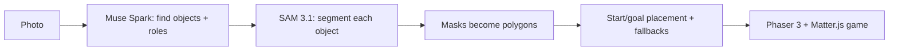

# Snaplevel

Photograph anything — a desk, a room, a street corner — and get a playable 2D platformer level in about a minute.

Live site: [https://snaplevel.vercel.app](https://snaplevel.vercel.app)

## How it works

Your photo goes through this pipeline, then you play the result:



1. **Muse Spark** finds up to 8 objects in the photo and assigns each a game role (platform, bouncy, slippery, hazard, decor) with a one-line reason.
2. **SAM 3.1** segments each object; masks are simplified into collision polygons (drops tiny fragments, retries once with a simpler noun on zero matches).
3. The assembler places a start and a reachable goal deterministically, adds a ground strip or generated platforms for sparse photos, and demotes blocking parts to scenery rather than shipping an unwinnable level.
4. You play it as a Phaser 3 + Matter.js platformer: run, jump, dodge hazards, reach the goal.

## Built with Meta

All model calls are server-side; the API key never reaches the browser.

- **Muse Spark** (`muse-spark-1.3`, vision + structured output) via the Meta Model API (OpenAI-compatible, `https://api.meta.ai/v1`) — finds objects and roles.
- **SAM 3.1** (`sam-3.1`) for segmentation — one call per object phrase, masks become polygons.
- **Muse Code**, the coding agent used to build this project.

The SAM request/streaming code in `src/lib/pipeline/segment.ts` adapts the `07_sam/01_api_basics/typescript/sam-api.ts` sample from the [Meta model cookbook](https://github.com/meta-models/meta-model-cookbook) (MIT License, © Meta Platforms, Inc.). See `docs/api-notes.md` for verified API behavior and measurements.

## Try it

- **Three example scenes** (Workbench, Living Room, Patio) on the landing page load instantly with no API calls.
- **Try a sample photo** plays the Workbench example without calling the build route.
- The **Chain** toggle in the game HUD shows the model chain behind any level: the photo, the objects Spark found, the SAM masks as coloured overlays, and per-step timings.

## Run locally

Prerequisites: [bun](https://bun.sh) 1.x.

```sh
bun install
cp .env.example .env.local
bun run dev
```

Then open http://localhost:3000.

| Variable | What it does |
| --- | --- |
| `MOCK_MODE=1` | Fixtures-only mode: the build route serves example levels with simulated progress, no key needed. |
| `MODEL_API_KEY` | Live mode (with `MOCK_MODE` unset): calls Meta's models server-side. Never committed. |

Other commands: `bun test`, `bun run build`.

## Limits and honesty

- Rate limits: **10 builds/hour per IP** and **200 builds/hour per server instance**, counted in memory.
- At most **8 objects** and **12 SAM calls** per photo; uploads must be JPEG/PNG/WebP under **5 MB** (the browser resizes to 1024 px first).
- "Simplified layout" cases: parts that would block the goal are demoted to non-colliding scenery ("Demoted so the level stays winnable") so the level stays beatable; the Chain panel shows what happened.
- Photos with no open space fail friendly: "This photo has no clear open space to stand on. Try one with a few distinct objects, like a desk, a shelf, or a table." Brighter photos with bigger objects make better levels.

## Privacy

- Uploaded photos are processed in memory on the server and are **not stored** — no files are written, no database, no photo log.
- Photos are sent to Meta's Model API for processing. Snaplevel calls Meta's Model API in standard mode, in which content is not used to train Meta's models (see [Meta's terms](https://dev.meta.ai/legal/terms-of-service)).
- Client IPs are read from forwarding headers on a best-effort basis and kept only in the in-memory rate-limit counters, which are lost when the server restarts.

## Credits and licence

- Example scenes are AI-generated (ChatGPT image generation), not photographs of real places or people.
- Game engine: [Phaser 3](https://phaser.io) with [Matter.js](https://brm.io/matter-js/) physics.
- MIT licence — see [LICENSE](LICENSE).
