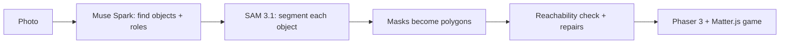

# Snaplevel

**Snap a photo. Play it as a level. Every level is checked winnable before you play it.**

Snaplevel turns any photo — a desk, a room, a street corner — into a playable 2D platformer in seconds. Meta's models find and outline the real objects in the photo; plain code then proves the goal can be reached under the game's own physics before the level ever loads. If a photo can't make a fair level, Snaplevel says so instead of handing you a broken one.

**Live:** [snaplevel.vercel.app](https://snaplevel.vercel.app) · **Demo video:** [YouTube](https://youtu.be/Z-FwnrJn_r0) · **Gallery:** [Meta Global AI Developer Hackathon #1967](https://cerebralvalley.ai/e/meta-ai-developer-hackathon/hackathon/gallery/1967)

## Try it in 30 seconds (no login, no key)

1. Open [snaplevel.vercel.app](https://snaplevel.vercel.app).
2. Pick one of the three example scenes (Workbench, Living Room, Patio). They load instantly and make **no** API calls.
3. Play: run, jump, dodge hazards, reach the portal.
4. Open the **Chain** toggle in the HUD to see what produced the level: the photo, the objects Muse Spark found and their roles, SAM's masks as coloured overlays, the per-step timings, and any notes the level checker added.
5. Upload your own photo to run the live pipeline end to end.

## Headline numbers

| What | Result | How it was measured |
| --- | --- | --- |
| Test suite | **189 tests pass, 0 fail** (1,091 assertions, 23 files) | `bun test` |
| Level checker | **31 tests** on sealed walls, roofed goals, slits narrower than the player, sparse photos and the fallback ladder | `src/lib/pipeline/assemble.test.ts` |
| Object finding (Muse Spark) | **5.1–8.0 s**, **8/8** sample photos returned valid structured output | 8-photo run, Oct 30 |
| Segmentation (SAM 3.1) | **1.9–3.2 s** per object; 4 objects in parallel finish in **2.5–3.6 s** | desk, kitchen, bench photos, Oct 30 |
| Full live build | **10–17 s** photo → playable level | garage, lamp, kitchen photos, Oct 31 |
| Zero-match rescue | one retry with a simpler noun recovered **4 of 6** objects SAM first missed | probe, Oct 31 |

Raw notes and every measurement: [`docs/api-notes.md`](docs/api-notes.md).

## Why you can trust the level

Generated levels are only fun if they are fair. Snaplevel never ships a level the checker can't prove is winnable.

**The checker uses the game's own physics.** The maximum jump height and jump gap are derived from the same constants the Matter.js game runs on (gravity, jump velocity, run speed), then halved as a safety margin for air friction and short taps (`src/game/physics.ts`).

**Two independent checks must both pass:**

1. **Flood fill** — fills the open space a player-sized body can occupy from the start. It catches walls, sealed pockets and gaps too narrow to fit through, which a box-level check can't see.
2. **Jump search** — walks platform to platform using the physics-derived jump limits, so a goal that is open but too high or too far fails.

**When a level fails, it is repaired in order, and every repair is shown in the Chain panel:**

1. Move the goal to another clear, reachable platform top.
2. Add a generated step so the goal is reachable.
3. Fall back to a simplified ground strip with the start at one end and the goal at the other.
4. Demote blocking objects to non-colliding scenery, one at a time, until the strip runs.
5. If nothing works, refuse with a friendly message instead of shipping an unwinnable level.

## How it works



1. **Muse Spark** finds up to 8 objects and gives each a game role (platform, bouncy, slippery, hazard, decor) with a one-line reason, as strict JSON.
2. **SAM 3.1** outlines each object. Masks become collision polygons; tiny fragments are dropped, and a zero-match object is retried once with a simpler noun Spark supplied.
3. **The assembler** places the start and goal deterministically and runs the checks above.
4. **You play it** as a Phaser 3 + Matter.js platformer.

## Meta models

| Model | ID | Job in Snaplevel |
| --- | --- | --- |
| Muse Spark | `muse-spark-1.3` | Reads the photo, lists up to 8 objects, assigns game roles and a fallback noun (vision + structured output). |
| SAM 3.1 | `sam-3.1` | Outlines each object; masks become collision shapes. One call per object, run in parallel. |
| Muse Code | — | The coding agent used to build this project (not called at runtime). |

All model calls go through the Meta Model API server-side; the API key never reaches the browser. The SAM streaming code in `src/lib/pipeline/segment.ts` adapts the `07_sam/01_api_basics/typescript/sam-api.ts` sample from the [Meta model cookbook](https://github.com/meta-models/meta-model-cookbook) (MIT License, © Meta Platforms, Inc.).

### What is a model call, and what is plain code

| Step | Who does it |
| --- | --- |
| Finding objects and choosing their roles | Muse Spark |
| Outlining objects | SAM 3.1 |
| Masks → polygons, start/goal placement, reachability, repairs | Plain TypeScript, deterministic |
| Game physics, controls, sound | Phaser 3 + Matter.js |
| Example scenes on the landing page | Pre-built fixtures — no model call |

## Honest limits

- **Not measured yet:** the share of real-world photos that produce a level without any repair. The checker guarantees winnability, not that every photo becomes an interesting level.
- **The checker is conservative.** Halving the jump limits means some levels a skilled player could beat still get an extra generated step.
- **Spark sometimes lists distant objects** (e.g. a parked car behind a bench) that become platforms.
- **Hard photos stay hard:** very dark scenes and tiny objects can still return zero SAM matches after the retry.
- **Rate limits:** 10 builds/hour per IP and 200 builds/hour per server instance, counted in memory.
- **Input caps:** at most 8 objects and 12 SAM calls per photo; JPEG/PNG/WebP under 5 MB (the browser resizes to 1024 px first).
- Photos with no open space fail with: "This photo has no clear open space to stand on. Try one with a few distinct objects, like a desk, a shelf, or a table." Brighter photos with bigger objects make better levels.

## Run locally

Prerequisites: [bun](https://bun.sh) 1.x.

```sh
bun install
cp .env.example .env.local
bun run dev
```

Then open http://localhost:3000.

| Variable | What it does |
| --- | --- |
| `MOCK_MODE=1` | Fixtures-only mode: the build route serves example levels with simulated progress, no key needed. |
| `MODEL_API_KEY` | Live mode (with `MOCK_MODE` unset): calls Meta's models server-side. Never committed. |

Other commands: `bun test`, `bun run build`.

## Privacy

- Uploaded photos are processed in memory on the server and are **not stored** — no files are written, no database, no photo log.
- Photos are sent to Meta's Model API for processing. Snaplevel calls it in standard mode, in which content is not used to train Meta's models (see [Meta's terms](https://dev.meta.ai/legal/terms-of-service)).
- Client IPs are read from forwarding headers on a best-effort basis and kept only in the in-memory rate-limit counters, which are lost when the server restarts.

## Built during the hackathon

- Solo entry, Indie Developer track; event window Oct 26 – Nov 4 2026 (first commit in this repo: Oct 29 2026).
- Built with laptop and phone only.
- The three example scenes are AI-generated images (see Credits), so the instant-play demo runs with zero API calls.

## Credits and licence

- Example scenes are AI-generated (ChatGPT image generation), not photographs of real places or people.
- Game engine: [Phaser 3](https://phaser.io) with [Matter.js](https://brm.io/matter-js/) physics.
- MIT licence — see [LICENSE](LICENSE).
